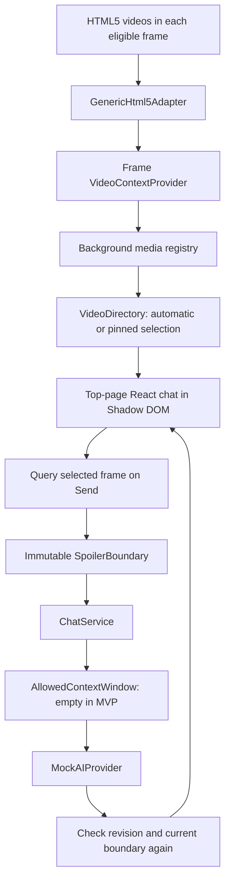
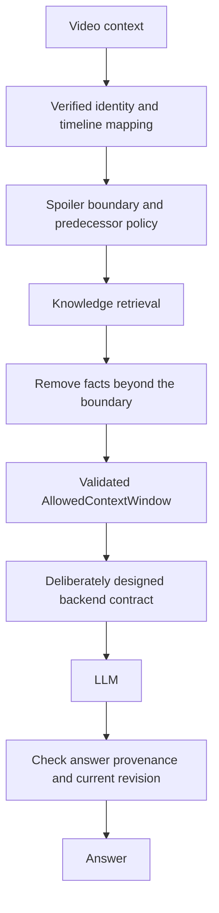

# Architecture

## Scope and invariant

This local MVP proves the path from a real video element to a bounded chat request. It has no external AI, movie database, recognition, or site-specific scraping.

**NO feature may expose information occurring after the user's current spoiler boundary.**

## Implemented flow

## Extension shell

`entrypoints/content/index.tsx` is the composition root. WXT generates the manifest from it and `wxt.config.ts`. It injects in the top frame of HTTP(S) documents after document idle. It runs in the extension's isolated JavaScript world, sharing the page DOM but not page JavaScript globals.

`entrypoints/collector.content.ts` separately injects a lightweight collector into every eligible frame, including cross-origin embeds. It uses `allFrames`, `matchAboutBlank`, and `matchOriginAsFallback` for browser-authorized related about/srcdoc/blob/data frames. The React bundle only runs in the top frame. No popup, options page, or backend is needed.

`entrypoints/background.ts` owns an in-memory media registry and routes extension messages. Collector and UI ports are separate; only top-page UI ports can watch/select/query. Tab/frame identities come from the browser's port sender, never page-provided IDs. Regular and incognito catalogs stay separate. Closing a frame or tab removes its entries. Workers may suspend: disconnect clears cached context, an active UI reconnects, and a broadcast rescan rebuilds the registry. No media catalog is persisted.

Refresh messages reach existing collectors in accessible tabs. Static content scripts do not retroactively appear in pages opened before installation/update; those pages need a reload. The implementation uses no network interception or page-world message bridge. See [Chrome content-script injection rules](https://developer.chrome.com/docs/extensions/develop/concepts/content-scripts).

The UI entrypoint creates the directory client, preference store, chat service, and mock, then mounts React using `createShadowRootUi`. Context invalidation disconnects listeners, observers, and timers; unmounting aborts chat requests and removes the UI. Page-hide stops collectors/connections; a persisted page-show restarts them after history restoration. See [WXT's lifecycle guidance](https://wxt.dev/guide/essentials/content-scripts).

## Video detection and adapters

Discovery walks the DOM structure and accessible open/closed shadow roots, without reading page text. Chrome's public `dom.openOrClosedShadowRoot` API and Firefox's privileged equivalent allow inspection of closed roots. Video controls and WDIM's own shadow tree are skipped. Cross-origin frames inspect their own documents and report to the worker; the parent does not attempt cross-origin DOM access. See [Chrome DOM API](https://developer.chrome.com/docs/extensions/reference/api/dom).

All discovered videos remain in the picker, including hidden paused elements. `VideoDirectory` ranks automatic candidates in the current tab by PiP, fullscreen, playing, visibility, last play, and area. Hidden videos qualify automatically when playing or in PiP. Selecting a player manually pins its ID across updates, including videos from another tab. A missing pin remains unavailable until it returns or the user chooses another source; it never silently switches to a different movie.

Chrome's [global media controls](https://chromium.googlesource.com/chromium/src/+/refs/tags/135.0.7017.0/components/global_media_controls/README.md) aggregate internal media sessions and Cast items. WDIM uses accessible HTML video elements, so identical coverage is not guaranteed. Remote-only casting, non-video surfaces, restricted pages, permissions-denied frames, and discarded tabs need separate treatment or remain inaccessible. Blob/MediaSource players do not require a direct media URL to read video timing.

`SiteAdapter` owns page support and media identity. The first supporting adapter wins; future specific adapters precede the generic fallback. Only `GenericHtml5Adapter` is implemented.

Its identity is an ephemeral random ID with **unverified** confidence. IDs use `crypto.getRandomValues`, which works in HTTP and opaque frame contexts where `randomUUID` is unavailable. See [Web Crypto context support](https://developer.mozilla.org/en-US/docs/Web/API/Crypto/getRandomValues). URL/source changes are local change detectors. A source URL is never treated as a movie identity: MediaSource, blob URLs, DRM, ads, and player replacement make that unreliable. The page title is explicitly labeled unverified.

The provider observes each discovered root and all videos. It checks timing/layout/SPA changes each second, deep scans every five seconds, and batches relevant mutations to avoid rescanning on every host-page update. Explicit Refresh immediately requests a deep scan. Progress events are throttled to four updates per second per frame; seek/play/pause/metadata/PiP events update immediately. Backward movement is never suppressed by progress throttling.

The catalog drives display, but Send and reply delivery each query actual properties from the selected video's owning frame. Timeouts fail closed. Catalog versions reject out-of-order replies; per-frame report versions keep unrelated tab activity from reviving stale context after a failed read. Per-video safety revisions preserve rewinds even if another video was selected at the time.

Timing before metadata is unknown. Non-finite duration is null; a known current time can still establish a mock boundary. Live/DVR media needs a stronger identity and timeline contract before story retrieval.

## Spoiler domain

- `PlaybackPosition`: current time and optional finite duration in seconds.
- `MediaIdentity`: opaque ID, title, confidence, optional series/release position.
- `SpoilerBoundary`: media ID, maximum allowed timestamp, explicitly allowed predecessor IDs.
- `KnowledgeFragment`: media ID, text, and the **latest reveal needed by any statement in the fragment**.
- `AllowedContextWindow`: boundary plus immutable filtered fragments.

Module-private TypeScript brands require normal callers to use domain factories. Runtime validation rejects unknown, negative, non-finite, and out-of-duration positions. Objects and nested arrays are frozen. Brands guard against accidental misuse, not malicious code or unchecked casts.

Current-media facts must have a finite, nonnegative reveal timestamp **≤** the boundary. A scene's start time is insufficient if its later lines reveal later information. Predecessors require explicit inclusion, verified identities, the same series, and earlier release order. Equal/later order, unrelated series, and uncertain identities are excluded. The MVP UI never enables predecessor context.

`ChatService` validates the question, copies/freezes the playback snapshot, derives its boundary, and passes the required allowed window to `AIProvider`. The mock receives an empty knowledge window. No unrestricted chat history is forwarded.

## Rewinds and asynchronous answers

A safety revision advances on backward movement, identity/selection changes, worker disconnection, or loss of known timing. React keys the conversation by that revision, removing old user/assistant messages and aborting pending work. **Any** backward seek starts over: a conservative policy even when some earlier messages might remain permissible.

Replies are checked against a fresh context, originating revision, and attached boundary before display. Render-time filtering adds a backstop. Rewind followed by a quick forward seek cannot resurrect an invalidated reply. User messages clear too because they may quote now-restricted answers.

Minimize retains memory; close clears it. Page reload and dev reinjection clear it. No transcript is persisted.

## UI, storage, fullscreen

Shadow DOM isolates selectors. Semantic tokens are defined on the widget root; pixel typography avoids host `rem` scaling. Keyboard/click bubbling is isolated from ordinary player shortcuts. A host's capture-phase listeners can still run first. Shadow DOM is style encapsulation, not a privacy/security boundary against a hostile page.

The dialog is nonmodal so the player remains usable. Escape minimizes and returns focus. Scrolling follows new messages near the bottom; otherwise it offers a new-message control.

`storage/preferences.ts` is the sole storage adapter. The entrypoint injects `browser.storage.local` from `wxt/browser`. Only theme persists. Reads validate values; writes serialize; failures leave the in-page theme usable with a status message.

Fullscreen uses the browser top layer; z-index cannot lift ordinary siblings above it. The widget moves inside a fullscreen container able to render DOM children, preserving React state. Native video/iframe fullscreen, platform video surfaces, and PiP are unsupported overlay locations. No fullscreen requests or browser restrictions are intercepted. See [MDN fullscreen behavior](https://developer.mozilla.org/en-US/docs/Web/API/Fullscreen_API/Guide).

## Privacy and permissions

Production requests only the `storage` API permission and declares HTTP(S) content-script matches. There is no tabs permission, programmatic scripting, network interception, cookie access, or backend host permission. Content matching still grants broad page access and can produce normal browser site-access warnings; users can restrict it.

Reads are limited to video timing/state, selection geometry, PiP/fullscreen state, count, page title (160-character cap), a video's accessible label/title (80-character cap), sanitized origin/path, and ephemeral identity. Tab/frame IDs and these small reports travel only within the extension. Query, hash, and credentials are omitted from the exposed URL. Full HTTP(S) URL and source exist only in local adapter change keys; exposed data/blob document URLs are reduced to their protocol. Titles and paths themselves can be sensitive and must be deliberately reviewed before any future transmission.

No body text, page HTML, subtitles, pixels, audio, or arbitrary surrounding content is collected. Application code makes no fetch, analytics, font, or AI requests. Development connects to WXT locally; the fixture loads bundled media. Firefox declares no off-device data collection.

## Future flow — not implemented

A real provider must not receive an unrestricted synopsis. Filter retrieval **before** invocation. Filtered retrieval alone still cannot guarantee a pretrained model will not introduce future facts from its own knowledge. Future work needs grounded answers, provenance, refusals, output checks, and adversarial tests. Annotation correctness is part of that trust boundary.

Start with a small verified story fixture and timestamped facts. Recognition, streaming integrations, subtitle ingestion, embeddings, vector stores, accounts, payments, and real LLM infrastructure remain deliberately absent.
