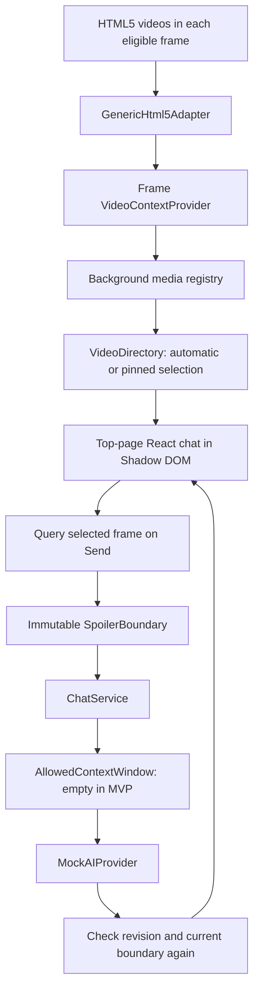
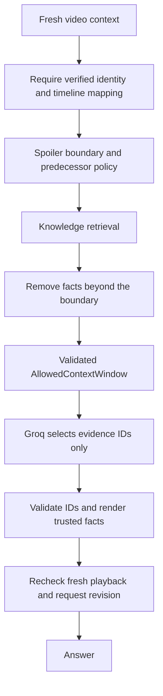

# Architecture

## Scope and invariant

This MVP connects playback to bounded chat requests. The default build is a local mock; the AI build uses a loopback gateway and Groq evidence selection over observed captions or verified catalog facts. Scoped platform caption readers do not imply movie recognition or a verified story timeline.

**NO feature may expose information occurring after the user's current spoiler boundary.**

## Implemented flow

## Extension shell

`entrypoints/content/index.tsx` is the composition root. WXT generates the manifest from it and `wxt.config.ts`. It injects in the top frame of HTTP(S) documents after document idle. It runs in the extension's isolated JavaScript world, sharing the page DOM but not page JavaScript globals.

`entrypoints/collector.content.ts` separately injects a lightweight collector into every eligible frame, including cross-origin embeds. It uses `allFrames`, `matchAboutBlank`, and `matchOriginAsFallback` for browser-authorized related about/srcdoc/blob/data frames. The React bundle only runs in the top frame. No popup, options page, or backend is needed.

`entrypoints/background.ts` owns an in-memory media registry and routes extension messages. Collector and UI ports are separate; only top-page UI ports can watch/select/query. Tab/frame identities come from the browser's port sender, never page-provided IDs. Regular and incognito catalogs stay separate. Closing a frame or tab removes its entries. Workers may suspend: disconnect clears cached context, an active UI reconnects, and a broadcast rescan rebuilds the registry. No media catalog is persisted.

Refresh messages reach existing collectors in accessible tabs. Static content scripts do not retroactively appear in pages opened before installation/update; those pages need a reload. The implementation uses no network interception or page-world message bridge. See [Chrome content-script injection rules](https://developer.chrome.com/docs/extensions/develop/concepts/content-scripts).

The UI entrypoint creates the directory client, preference store, chat service, and build-selected provider, then mounts React using `createShadowRootUi`. Context invalidation disconnects listeners, observers, and timers; unmounting aborts chat requests and removes the UI. Page-hide stops collectors/connections; a persisted page-show restarts them after history restoration. See [WXT's lifecycle guidance](https://wxt.dev/guide/essentials/content-scripts).

## Video detection and adapters

Discovery walks the DOM structure and accessible open/closed shadow roots, without reading page text. Chrome's public `dom.openOrClosedShadowRoot` API and Firefox's privileged equivalent allow inspection of closed roots. Video controls and WDIM's own shadow tree are skipped. Cross-origin frames inspect their own documents and report to the worker; the parent does not attempt cross-origin DOM access. See [Chrome DOM API](https://developer.chrome.com/docs/extensions/reference/api/dom).

All discovered videos remain in the picker, including hidden paused elements. `VideoDirectory` ranks automatic candidates in the current tab by PiP, fullscreen, playing, visibility, last play, and area, excluding confirmed ad players. Hidden videos qualify automatically when playing or in PiP. Starting a question holds the selected player for that conversation, so a separate playing ad cannot take over. This hold survives minimizing, context invalidation, and disappearance; closing chat releases it. The picker labels the hold and allows choosing Automatic or another player. Selecting a player manually pins its ID across updates, including videos from another tab; closing chat does not release an explicit pin. A missing held/pinned player remains unavailable until it returns or the user changes selection; it never silently switches to a different movie.

Chrome's [global media controls](https://chromium.googlesource.com/chromium/src/+/refs/tags/135.0.7017.0/components/global_media_controls/README.md) aggregate internal media sessions and Cast items. WDIM uses accessible HTML video elements, so identical coverage is not guaranteed. Remote-only casting, non-video surfaces, restricted pages, permissions-denied frames, and discarded tabs need separate treatment or remain inaccessible. Blob/MediaSource players do not require a direct media URL to read video timing.

`SiteAdapter` owns page support and media identity. The first supporting adapter wins; future specific adapters precede the generic fallback. Only `GenericHtml5Adapter` is implemented.

Its identity is an ephemeral random ID with **unverified** confidence. IDs use `crypto.getRandomValues`, which works in HTTP and opaque frame contexts where `randomUUID` is unavailable. See [Web Crypto context support](https://developer.mozilla.org/en-US/docs/Web/API/Crypto/getRandomValues). URL/source changes are local change detectors. A source URL is never treated as a movie identity: MediaSource, blob URLs, DRM, ads, and player replacement make that unreliable. The page title is explicitly labeled unverified.

The provider observes each discovered root and all videos. It checks timing/layout/SPA changes each second, deep scans every five seconds, and batches relevant mutations to avoid rescanning on every host-page update. Explicit Refresh immediately requests a deep scan. Progress events are throttled to four updates per second per frame; seek/play/pause/metadata/PiP events update immediately. Backward movement is never suppressed by progress throttling.

The catalog drives display, but Send and reply delivery each query actual properties from the selected video's owning frame. Timeouts fail closed. Catalog versions reject out-of-order replies; per-frame report versions keep unrelated tab activity from reviving stale context after a failed read. Per-video safety revisions preserve rewinds even if another video was selected at the time.

Timing before metadata is unknown. Non-finite duration is null; an initially known current time can still establish an unverified mock boundary. Live/DVR media needs a stronger identity and timeline contract before story retrieval.

## Ads and story timing

`PlaybackContext.rawPosition` contains the sampled video clock. `position` contains the adapter's mapped story position, a held position during a confirmed ad, or an explicitly unverified player position for the empty local mock. `timeline` records phase (`content`, `ad`, `unclassified`, `unknown`), mapping (`verified`, `unverified`, `unavailable`), and content-session continuity (`established`, `unknown`). Timeline verification is separate from movie identification.

`SiteAdapter.readPlayback` receives fresh raw timing and returns media identity, position, and timeline evidence. A future adapter may report a confirmed ad only with established continuity of the same content session. It must supply validated story-time mapping for stitched ads and identify a changed content session even if the video element remains the same. A missing mapping, ambiguous player replacement, or lost context must be unknown. No production site-specific adapter, player SDK bridge, manifest interception, ad selector, or ad recognition is implemented.

The generic adapter reports known player timing as **unclassified/unverified**, never as confirmed content or an ad. A change from an established finite duration latches timeline uncertainty for that ephemeral media identity. Returning to the original duration or refreshing does not prove continuity and does not clear uncertainty. A new source/page identity or page reload starts a new unverified session. A raw rewind still invalidates chat; a source change still creates a new identity. These signals never become evidence of advertising. Seamless stitched ads cannot be detected from timing alone.

`domain/spoilers/playback.ts` owns validity, ad-position holding, and invalidation policy. A confirmed ad can retain the previous safe story position only while the same mapped session is continuously observed. Repeated ads cannot advance it; an earlier reported story position is still a rewind. Prerolls without a prior safe position, lost continuity, or changed identity fail closed. Unknown position is never replaced with a cached value to authorize a request.

During confirmed ads, the UI preserves safe existing messages and shows a quiet tracking-paused status. Sends and reply delivery are blocked. `requestRevision` advances on ad entry/exit and request eligibility changes; it cancels pending work without changing the conversation's `safetyRevision`. Both revisions are monotonic per video and propagated through the authenticated frame catalog, preserving cancellation through a fast ad/content transition. Unknown context, rewinds, selection/media changes, removal, timeout, and disconnection still invalidate conversations. Sends and replies query the owning frame again. No video playback controls are invoked by this mechanism.

## Spoiler domain

- `PlaybackPosition`: current time and optional finite duration in seconds.
- `MediaIdentity`: opaque ID, title, confidence, optional series/release position.
- `SpoilerBoundary`: media ID, maximum allowed timestamp, timeline mapping basis, explicitly allowed predecessor IDs.
- `KnowledgeFragment`: media ID, text, and the **latest reveal needed by any statement in the fragment**.
- `AllowedContextWindow`: boundary plus immutable filtered fragments.

Module-private TypeScript brands require normal callers to use domain factories. Runtime validation rejects unknown, negative, non-finite, and out-of-duration positions. Objects and nested arrays are frozen. Brands guard against accidental misuse, not malicious code or unchecked casts.

Current-media facts must have a finite, nonnegative reveal timestamp **≤** the boundary. A scene's start time is insufficient if its later lines reveal later information. Predecessors require explicit inclusion, verified identities, the same series, and earlier release order. Equal/later order, unrelated series, and uncertain identities are excluded. The MVP UI never enables predecessor context.

`ChatService` validates the question, copies/freezes the playback snapshot including raw timing and timeline evidence, derives its boundary, and passes the required allowed window to `AIProvider`. Boundary creation rejects ad/unknown phases and unavailable continuity. `filterAllowedKnowledge` excludes every fragment for an unverified timeline, regardless of timestamp. Unverified player boundaries support only the empty local mock, not story retrieval. The mock receives an empty knowledge window. No unrestricted chat history is forwarded.

## Rewinds and asynchronous answers

A safety revision advances on backward movement, identity/selection changes, worker disconnection, or loss of known timing. React keys the conversation by that revision, removing old user/assistant messages and aborting pending work. **Any** backward seek starts over: a conservative policy even when some earlier messages might remain permissible.

Replies are checked against a fresh context, originating revision, and attached boundary before display. Render-time filtering adds a backstop. Rewind followed by a quick forward seek cannot resurrect an invalidated reply. User messages clear too because they may quote now-restricted answers.

Minimize retains memory; close clears it. Page reload and dev reinjection clear it. No transcript is persisted.

## UI, storage, fullscreen

Shadow DOM isolates selectors. Semantic tokens are defined on the widget root; pixel typography avoids host `rem` scaling. Keyboard/click bubbling is isolated from ordinary player shortcuts. A host's capture-phase listeners can still run first. Shadow DOM is style encapsulation, not a privacy/security boundary against a hostile page.

The dialog is nonmodal so the player remains usable. Escape minimizes and returns focus. Scrolling follows new messages near the bottom; otherwise it offers a new-message control.

`storage/preferences.ts` is the sole storage adapter. The entrypoint injects `browser.storage.local` from `wxt/browser`. Only theme persists. Reads validate values; writes serialize; failures leave the in-page theme usable with a status message.

Fullscreen uses the browser top layer; z-index cannot lift ordinary siblings above it. The widget moves inside a fullscreen container able to render DOM children, preserving React state. Native video/iframe fullscreen, platform video surfaces, and PiP are unsupported overlay locations. No fullscreen requests or browser restrictions are intercepted. See [MDN fullscreen behavior](https://developer.mozilla.org/en-US/docs/Web/API/Fullscreen_API/Guide).

## Privacy and permissions

The default build requests only the `storage` API permission and declares HTTP(S) content-script matches. The opt-in AI build adds the loopback host permission `http://127.0.0.1/*`; application code uses only port 8787. There is no tabs permission, programmatic scripting, network interception, or cookie access. Content matching still grants broad page access and can produce normal browser site-access warnings; users can restrict it.

Reads are limited to video timing/state, selection geometry, PiP/fullscreen state, count, page title (160-character cap), a video's accessible label/title (80-character cap), sanitized origin/path, and ephemeral identity. Tab/frame IDs and these small reports travel only within the extension. Query, hash, and credentials are omitted from the exposed URL. Full HTTP(S) URL and source exist only in local adapter change keys; exposed data/blob document URLs are reduced to their protocol. Titles and paths themselves can be sensitive and must be deliberately reviewed before any future transmission.

The AI build additionally observes bounded displayed captions through native tracks and scoped platform readers. No arbitrary body text, page HTML, pixels, audio, hidden transcripts, or surrounding content is collected. Only selected-frame evidence, platform/asset identity, options, the current question, and fresh boundary are sent on Send. Catalog broadcasts contain caption counts/status only. The default build does not capture captions or make AI requests. No chat history, page title, or browsing URL is forwarded. There are no analytics or remote fonts. Firefox declares personal communications and website content for the AI build. Vendor retention is separate from local storage; see [AI setup and privacy](AI.md).

## Opt-in grounded AI flow

`GroundedAIProvider` chooses verified story retrieval or observed captions from the current ephemeral session. Missing evidence refuses locally with caption instructions. Its transport opens an extension port; the background accepts only its own top-frame, non-incognito sender. Cancellation aborts the gateway fetch. The gateway binds to `127.0.0.1:8787`, requires exact Host/configured Origin, enforces body/time/concurrency/rate limits, and keeps no request logs. This is a trusted local development service, not a public authenticated backend.

`GroundedService` reconstructs the boundary against a trusted operator catalog, removes later/foreign facts, and limits the evidence window to the latest 32 eligible facts. Empty/unknown catalogs refuse without calling Groq. `GroqEvidenceModel` uses strict structured output with evidence IDs only. Domain validation rejects unknown/duplicate IDs, extra fields, invalid status, and more than four selections. Trusted fact text and timestamps are rendered deterministically, then checked again in the extension. Model-generated prose and reasoning never become answers. Model relevance/refusal can still be imperfect; no model choice makes incorrect annotations safe.

`CaptionCollector` reads displayed active cues and scoped caption surfaces only in the AI build. `readVideo` attaches the selected buffer to an authenticated reply; caption text never enters the registry/catalog. `CaptionService` validates the request and constructs a separate `observed-captions` window. This never upgrades movie confidence or relaxes the verified-story filter. Client validation requires returned captions to exactly match supplied observations. Only selected evidence IDs become answers.

Optional background uses a bounded Wikidata human-name/creative-occupation lookup anchored in the question and observed captions. A separate operator-reviewed source catalog allows background and earlier works, requiring exact asset association, an already-mentioned topic, explicit options, and strict release order for prior works. Outside facts are filtered before invocation and labeled separately. No article prose, unrestricted plot search, or model-written external facts are accepted. See [AI.md](AI.md) and [PLATFORMS.md](PLATFORMS.md) for source trust and coverage limits.
